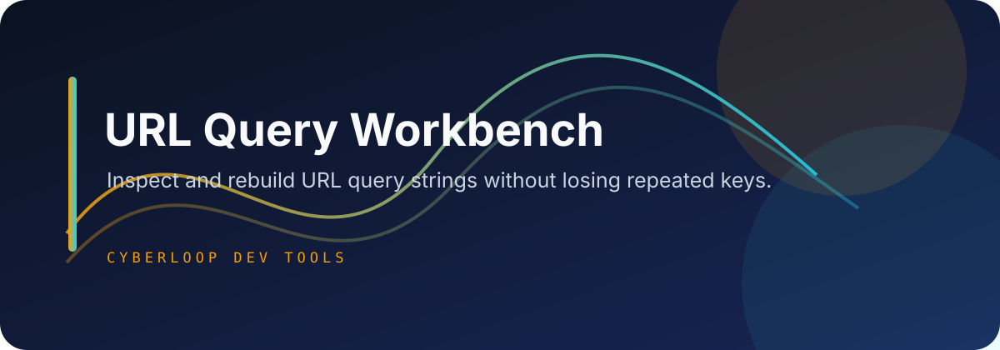

<div align="center">


<a href="https://github.com/CyberLoop-dev/url-query-workbench">

</a>

<p><strong>Edit URL query parameters locally while preserving repeated keys and empty values.</strong></p>

[](LICENSE)
[](https://github.com/CyberLoop-dev/url-query-workbench)
[](https://github.com/CyberLoop-dev/url-query-workbench/stargazers)
[](https://github.com/CyberLoop-dev/url-query-workbench/commits/main)



</div>

## ✨ Overview

Edit URL query parameters locally while preserving repeated keys and empty values. **URL Query Workbench** is a small, focused Node.js and browser JavaScript project. It runs locally, keeps user data in the browser, and is designed to be easy to inspect and extend.

## 🚀 Features

- ✨ 🔎 Parse an absolute URL into editable query rows.
- ✨ ➕ Add, remove, and rebuild query parameters.
- ✨ 🔁 Preserve repeated keys and empty values.
- ✨ 📋 Copy the rebuilt URL when browser clipboard access is available.

## 🖥️ Demo

Run `npm start`, open `http://127.0.0.1:4173`, and use the controls in the page. The sample URL includes repeated `tag` parameters and an empty value; edit the rows and build it again.

## ⚡ Quick Start

```bash
npm start
```

No third-party npm packages are required.

## 🧰 Tech Stack

- **Runtime:** Node.js (built-in HTTP server)
- **Frontend:** HTML, CSS, browser JavaScript
- **Dependencies:** None

## 📁 Folder Structure

```text
url-query-workbench/
├── assets/overview.svg
├── public/index.html
├── server.js
├── package.json
├── .gitignore
├── LICENSE
└── README.md
```

## 🗺️ Roadmap

- [ ] Add drag-and-drop parameter ordering.
- [ ] Add percent-encoding inspection for individual values.

## 🤝 Contributing

Issues and pull requests are welcome. Keep changes focused, explain behavior changes, and include reproducible steps for reported bugs.

## 📄 License

Released under the [MIT License](LICENSE).

<div align="center">

</div>
